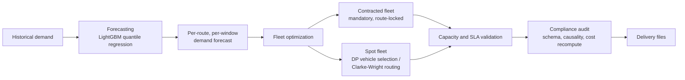

# TEKNOFEST 2026: AI-Supported Logistics Mainline Optimization


**Team ARTAI**, Semi-Finalist (Gelişmiş Çözüm Aşaması)

Forecasting and optimization pipeline for a nationwide vehicle-routing
problem, built for TEKNOFEST 2026's AI-Supported Logistics Mainline
Optimization competition (Hepsiburada × T3 Vakfı). The competition ran in
two stages, each scored on demand-forecast accuracy and total fleet cost
under a growing set of real-world operational constraints.

---

## Results

| Stage | Total cost | Coverage | Rule violations |
|---|---:|:---:|:---:|
| **MVP**: Temel İşlevli Çözüm | 10,891,866 TL | 100% | 0 |
| **Advanced**: Gelişmiş Çözüm | 16,887,305 TL | 100% | 0 |

Both submissions cut cost 15–45% below a naive direct-dispatch baseline and
passed a full independent audit (output schema, ID formats, demand
conservation, capacity limits, and per-row jury cost recomputation) before
delivery.

---

## Problem

Two-part problem, repeated across two stages of increasing complexity:

1. **Demand forecasting**: predict volumetric demand (desi) between
   transfer centers for a target week, from ~130–180 days of history.
2. **Fleet optimization**: assign a mixed fleet (contracted + spot;
   Tır / Kamyon / Hafif Kamyon / Kamyonet) to cover that demand at minimum
   cost, under hard rules on fleet usage, capacity, and scheduling.

| | MVP stage | Advanced stage |
|---|---|---|
| Granularity | Daily | Hourly (two demand windows/day) |
| Routes | 89 | 289 |
| Distance | Haversine (straight-line) | Real road-distance matrix |
| Consolidation | Not allowed | Allowed (double handling cost) |
| SLA penalty | None | `delayed_desi × delay_hours × 0.4 TL` |
| Capacity limits | None | Handling capacity + Tır dock capacity per center/day |

---

## Approach



**Forecasting**: LightGBM quantile regression (`α = 0.5`), selected after
backtesting multiple quantiles against realized cost. Anomaly detection
flags holiday and month-end demand collapses and imputes them with
same-weekday medians so lag features aren't corrupted by broken history.

**Optimization**: MVP used exact/DP vehicle selection where the search
space allowed it. The advanced stage's larger state space (hourly windows,
consolidation, SLA penalties) called for a Clarke-Wright savings heuristic
with mixed-fleet tour construction, hard capacity gating, and multi-day
deferral for dispatch windows that would otherwise breach capacity.

**Validation**: every deliverable is checked against the literal
competition rules before submission: exact output schema, ID format
(`D#####`, `V####`), full demand conservation to final destination,
zero capacity violations, and independent per-row cost recomputation to
catch any gap between the stated and jury-recomputed total.

---

## Repository structure

| Path | What it is |
|---|---|
| [`mvp-stage/1_forecasting.py`](mvp-stage/1_forecasting.py) | MVP demand forecast → `Desi_talep.xlsx` |
| [`mvp-stage/2_optimization.py`](mvp-stage/2_optimization.py) | MVP fleet assignment → `Arac_Kapasite_Maliyet.xlsx` |
| [`mvp-stage/cozum_pipeline_full.py`](mvp-stage/cozum_pipeline_full.py) | MVP forecasting + optimization in one end-to-end script |
| [`advanced-stage/1_forecasting.py`](advanced-stage/1_forecasting.py) | Hourly, per-window forecast for the advanced stage |
| [`advanced-stage/2_optimization.py`](advanced-stage/2_optimization.py) | Clarke-Wright mixed-fleet routing with capacity and SLA handling |
| [`docs/`](docs) | Methodology reports for both stages and the MVP journey summary |
| [`requirements.txt`](requirements.txt) | Python dependencies |

## Running it

```bash
pip install -r requirements.txt
```

Each script expects a local `data/` folder with the competition's input
files (see the `pd.read_excel(...)` calls at the top of each script for
exact filenames). Competition datasets are not included in this repo; see
[Data](#data) below.

```bash
cd mvp-stage
python 1_forecasting.py   # -> Desi_talep.xlsx
python 2_optimization.py  # -> Arac_Kapasite_Maliyet.xlsx
```

The advanced stage runs the same way from `advanced-stage/`.

## Data

Competition-provided datasets (demand history, vehicle cost tables,
transfer-center coordinates and capacities) were supplied under the
competition's terms and are not republished here. The code expects them
under `data/`; swap in equivalent data to reproduce the pipeline structure.

## License

MIT, see [LICENSE](LICENSE). Shared for portfolio and demonstration purposes.
